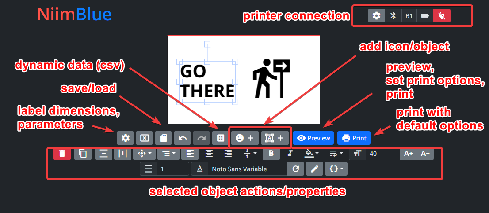
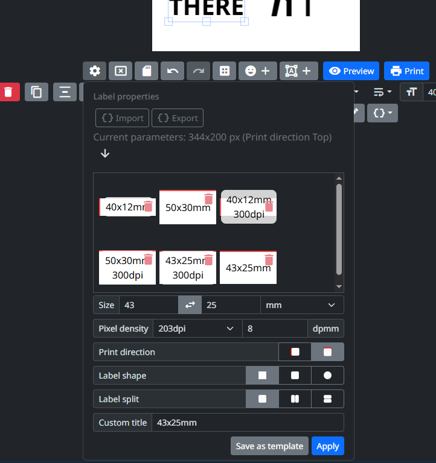
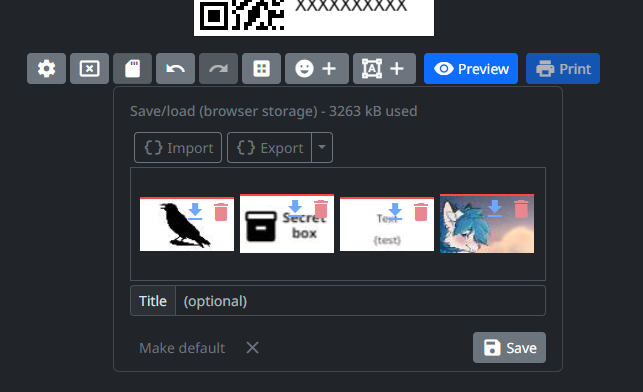
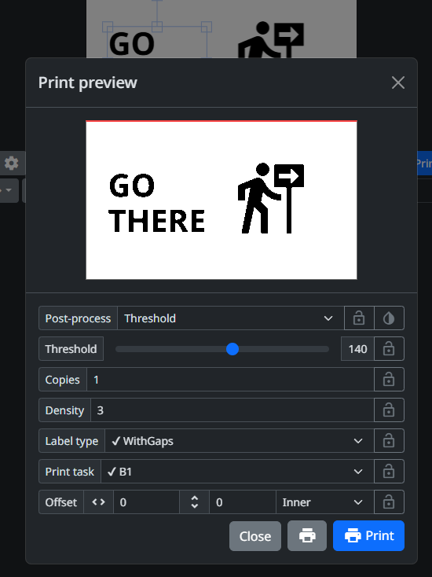
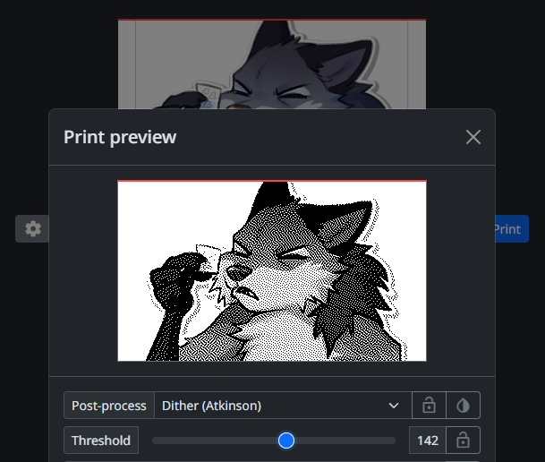
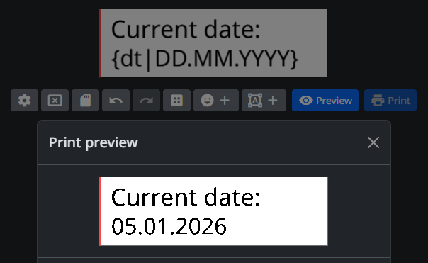
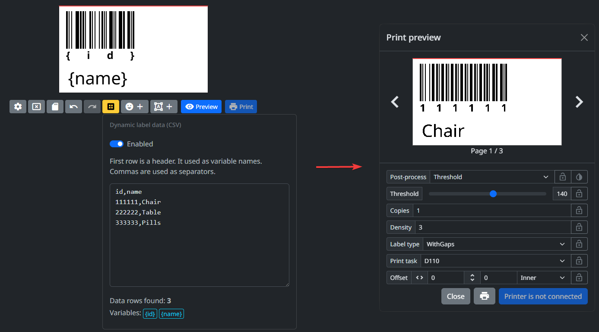
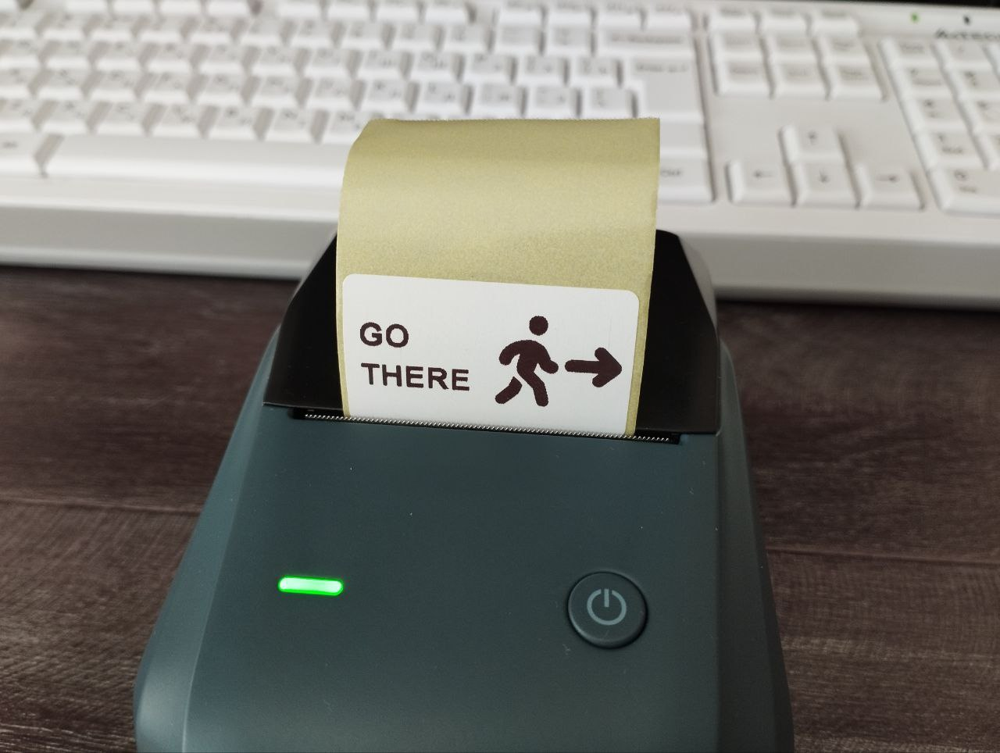
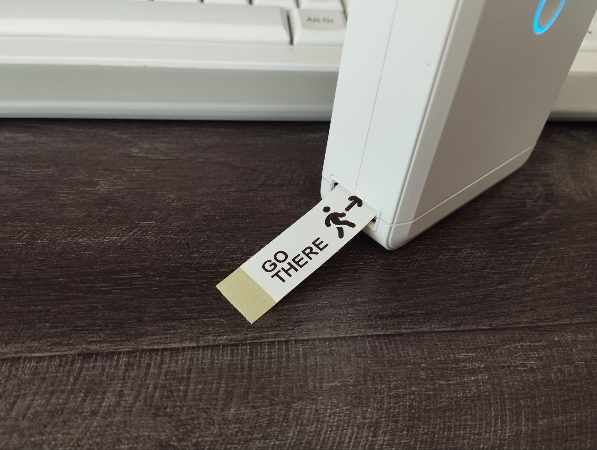

<div align="center">

[](https://niim.blue)

# NiimBlue — Desktop & Mobile Edition

**Design and print labels on NIIMBOT label printers — from a real app on Windows, macOS, or Android.**


</div>

> [!IMPORTANT]
> ### All credit goes to the original project
> This is a personal fork of **[NiimBlue by MultiMote](https://github.com/MultiMote/niimblue)**.
> The label editor, the printer protocol ([NiimBlueLib](https://github.com/MultiMote/niimbluelib)), the translations and practically all of the work are theirs.
> This fork only packages it as installable desktop/mobile apps and adds a few small editor tweaks (listed below).
>
> If this app is useful to you, please **star and support the original**:
> [GitHub](https://github.com/MultiMote/niimblue) · [Website](https://niim.blue) · [Boosty](https://boosty.to/multimote) · [Lava](https://app.lava.top/mithriss_art?tabId=donate) · [Discord](https://discord.gg/jXPAfZVd8a) · [Telegram](https://t.me/niimblue)

---

## What is this?

NIIMBOT makes small, inexpensive thermal label printers (B1, B21, D11, D110 and more). Their official app is phone-only, needs an account, and is limited.

**NiimBlue** is a free, open-source replacement. It lets you:

- **Design labels** — text, images, barcodes, QR codes, shapes, lines, custom fonts.
- **Print over Bluetooth or USB** — no account, no cloud, no internet needed.
- **Preview before printing** — see exactly how the printer will render your label, with several image-processing (dithering) options.
- **Save and reuse** — keep label templates, import/export them as files.
- **Batch print** — fill labels from a spreadsheet (CSV) with dynamic fields.
- **Stay private** — everything runs on your own device. No data is sent anywhere.

The original NiimBlue runs in a web browser at [niim.blue](https://niim.blue). This fork wraps it into **apps you install**, so you don't need a browser with Bluetooth support, and it works offline like any other program.

## Download & install

Get the latest files from the **[Releases page](../../releases/latest)**.

| Platform | File | How to install |
|---|---|---|
| **Windows** 10/11 | `NiimBlue-Setup-x.x.x.exe` | Run it and follow the installer. If Windows SmartScreen warns you, click **More info → Run anyway** (the app isn't code-signed). |
| **macOS** (Intel & Apple Silicon) | `NiimBlue-x.x.x-universal.dmg` | Open the `.dmg` and drag **NiimBlue** into **Applications**. The first time, **right-click the app → Open** (or allow it under *System Settings → Privacy & Security*), because it isn't signed with an Apple developer account. Allow Bluetooth access when asked. |
| **Android** 7+ | `NiimBlue.apk` | Download it on your phone, open it, and allow "install from unknown sources" if asked. Allow Bluetooth/Location permissions when asked. |

## How to use

1. Turn on your NIIMBOT printer.
2. Open NiimBlue and click **Bluetooth** (or **Serial (USB)** if it's plugged in by cable).
3. Pick your printer from the list. Desktop apps scan for a few seconds before showing the list.
4. Choose your label size, design your label, then click **Print**.

> [!TIP]
> If a print comes out wrong or blank, open the print preview and try a different **print task version**, then press **Lock** to remember it.
> More help: [Original FAQ](https://github.com/MultiMote/niimblue/wiki/Frequently-asked-questions).

## What this fork changes

Everything not listed here is the original NiimBlue.

- **Installable apps**: Windows `.exe` and macOS `.dmg` built with Electron, so Bluetooth and USB work the same on both. Android `.apk` built from the original Capacitor project.
- **Device picker**: a simple native window to choose your printer in the desktop apps.
- **Editor tweaks**: character spacing for text, a larger working area, zoom controls, a resize handle and auto-fit.
- **Fonts**: you can also upload `.woff` and `.otf` font files.
- **Connection help**: the Bluetooth option is always visible, with a short guide.

## Supported printers

The original project aims to support as many NIIMBOT models as possible. See the [list of tested models](https://github.com/MultiMote/niimbluelib/issues/1).

If your model doesn't print, the original author asks for a [packet capture](https://github.com/MultiMote/niimblue/wiki/Making-packet-capture) from the official app. Please report printer and protocol issues to the **[original project](https://github.com/MultiMote/niimblue/issues)**. Only report problems with the desktop/Android packaging here.

## Screenshots

Some screenshots are from the original project and may be outdated.



<details>
<summary>⬇ More images ⬇</summary>

Label properties:



Save/load menu:



Print preview dialog:



Post-processing:



Templating:



Dynamic data:



In real life:




</details>

## For developers

### Run the web app locally

Requires [Node.js](https://nodejs.org) 24+.

```bash
git clone https://github.com/b34tl86/niimblue-web.git
cd niimblue-web
npm i
npm run dev
```

### Build the desktop app (Windows / macOS)

```bash
npm i
cd standalone-apps/electron
npm i
npm run start   # run it without installing (builds www first: npm run build-www)
npm run dist    # build the installer for the current OS into standalone-apps/electron/dist
```

A macOS `.dmg` can only be built on a Mac.

### Build the Android app

See [standalone-apps/capacitor/README.md](standalone-apps/capacitor/README.md).

### Automatic builds

[.github/workflows/apps.yml](.github/workflows/apps.yml) builds the Windows, macOS and Android apps on GitHub. When you push a tag like `v2026.9.0`, the files are attached to a GitHub Release. You can also start a build manually from the **Actions** tab.

## License & credits

MIT License — see [LICENSE](LICENSE). Copyright © 2024 **MultiMote**.

- Original app: [MultiMote/niimblue](https://github.com/MultiMote/niimblue)
- Printer library: [MultiMote/niimbluelib](https://github.com/MultiMote/niimbluelib)
- Protocol documentation: [NIIMBOT Community Wiki](https://printers.niim.blue)
- Translations: [the NiimBlue Weblate community](https://weblate.mmote.ru/engage/niimblue/)

This fork is not affiliated with NIIMBOT or with the original author.
